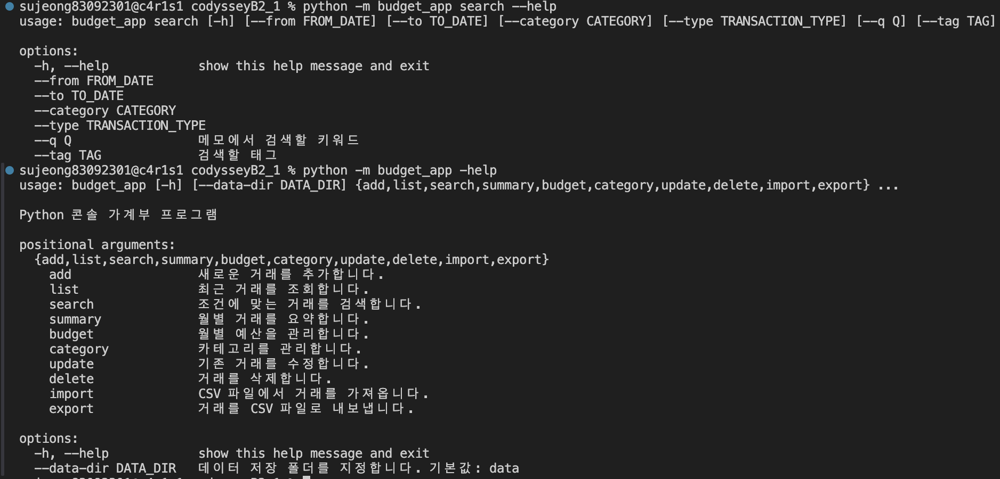
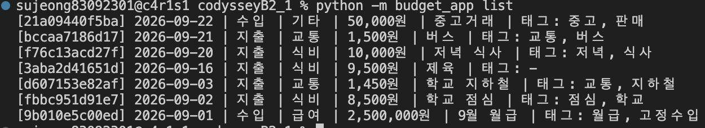
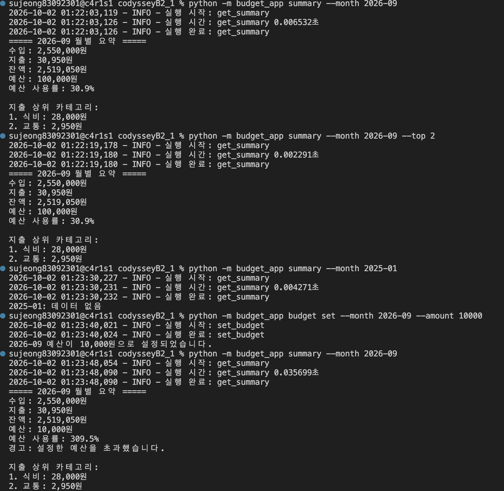

# Python 콘솔 가계부

Python 표준 라이브러리만을 사용하여 구현한 **콘솔 기반 가계부 프로그램**입니다.
거래 내역, 카테고리, 월별 예산을 파일에 저장하여 프로그램을 종료한 후에도 데이터를 유지할 수 있도록 구현했습니다.

## 주요 기능

1. **거래 추가**

   * 날짜, 수입/지출 유형, 카테고리, 금액, 메모, 태그 입력
   * 거래 ID 자동 생성
   * 입력값 검증 및 오류 안내
2. **거래 목록 조회**

   * 최신 날짜순으로 거래 내역 조회
   * `--limit` 옵션으로 출력 개수 제한

3. **거래 검색**

   * 기간(`--from`, `--to`)
   * 카테고리(`--category`)
   * 거래 유형(`--type`)
   * 메모 검색(`--q`)
   * 태그 검색(`--tag`)
   * 여러 조건을 함께 사용 가능

4. **월별 요약**

   * 월별 수입 합계
   * 월별 지출 합계
   * 잔액 계산
   * 지출 카테고리별 금액 및 상위 카테고리 출력
   * 예산 사용률 및 초과 여부 확인

5. **월별 예산 관리**

   * 월별 예산 설정
   * 예산 사용률 계산
   * 예산 초과 시 경고 출력

6. **카테고리 관리**

   * 카테고리 추가/조회/삭제
   * 거래에서 사용 중인 카테고리는 삭제 방지

7. **거래 수정**

   * 거래 ID를 기준으로 수정
   * 옵션 방식으로 수정할 항목 지정

8. **거래 삭제**

   * 거래 ID를 기준으로 삭제
   * 존재하지 않는 ID 입력 시 오류 안내

9. **CSV 가져오기/내보내기**

   * CSV 파일에서 거래 내역 가져오기
   * 월별 또는 기간별 거래 내역 CSV 내보내기
   * 가져오기/내보내기 처리 건수 출력

10. **파일 기반 데이터 저장**

    * 거래 내역, 카테고리, 예산을 각각 별도의 JSONL 파일에 저장
    * 프로그램 실행 시 필요한 파일 자동 생성

---

## 실행 화면

### 메인 실행 화면



### 거래 목록



### 월별 요약



---

## 실행 환경

* Python 3.10 이상 (macOS 기본 Python 3.9에서도 전체 기능 동작 확인)
* Python 표준 라이브러리 사용
* 별도의 외부 패키지 설치 없이 실행 가능

### ⚠️ 주의사항 (macOS)

Windows는 python.org 설치 시 **"Add python.exe to PATH"**를 체크하면 `python` 명령을 바로 사용할 수 있습니다.
macOS는 환경에 따라 아래 문제가 생길 수 있습니다.

| 증상 | 원인 | 해결 |
|---|---|---|
| `zsh: command not found: python` | macOS 12.3부터 `python` 명령이 제거되고 `python3`만 제공됨 | 이 문서의 `python`을 `python3`로 바꿔 실행하거나, 아래처럼 `python`을 연결 |
| `python3 --version`이 3.9로 나옴 | 기본 `python3`는 Xcode Command Line Tools에 포함된 3.9 | 그대로 사용 가능 (`from __future__ import annotations`로 3.9 호환 처리) |
| 3.12를 설치했는데 터미널은 여전히 3.9 | 새로 설치한 Python이 PATH에 연결되지 않음 | 아래 명령으로 연결 |
| VS Code ▶ 버튼 실행 시 `attempted relative import` 오류 | 패키지 내부 파일을 단독 실행함 | 터미널에서 프로젝트 루트 기준 `python -m budget_app ...`으로 실행 |

설치한 Python(예: Homebrew 3.12)을 `python` / `python3` 명령으로 연결하는 방법:

```bash
which -a python3 python3.12            # 설치 위치 확인 (예: /usr/local/bin/python3.12)
mkdir -p ~/.local/bin
ln -sf /usr/local/bin/python3.12 ~/.local/bin/python
ln -sf /usr/local/bin/python3.12 ~/.local/bin/python3
echo 'export PATH="$HOME/.local/bin:$PATH"' >> ~/.zshrc
source ~/.zshrc
python --version                       # Python 3.12.x
```

---

## 실행 방법

프로젝트 루트 디렉터리에서 다음 명령어를 실행합니다.

```bash
python -m budget_app --help
```

기본 데이터 저장 위치는 다음과 같습니다.

```text
./data/
```

데이터 저장 위치는 `--data-dir` 옵션으로 변경할 수 있습니다.

```bash
python -m budget_app --data-dir ./mydata list
```

프로그램 실행에 필요한 데이터 파일이 존재하지 않는 경우 자동으로 생성됩니다.

---

## 시연용 예시 데이터

`data/*.jsonl`을 모두 지운 빈 상태에서도 바로 시연할 수 있도록 **4개월(2026-08 ~ 2026-11) × 3건 = 12건** 예시 데이터를 준비했습니다.
카테고리는 최초 실행 시 자동 생성되는 기본 카테고리만 사용합니다.

| 월 | 날짜 | 유형 | 카테고리 | 금액 | 메모 | 태그 |
|---|---|---|---|---:|---|---|
| 8월 | 2026-08-01 | income | 급여 | 2,500,000 | 8월 월급 | 월급, 고정수입 |
| | 2026-08-05 | expense | 주거 | 550,000 | 8월 월세 | 월세, 고정지출 |
| | 2026-08-17 | expense | 식비 | 32,000 | 친구랑 저녁 | 외식 |
| 9월 | 2026-09-01 | income | 급여 | 2,500,000 | 9월 월급 | 월급, 고정수입 |
| | 2026-09-12 | expense | 교통 | 55,000 | 교통카드 충전 | 교통 |
| | 2026-09-24 | expense | 쇼핑 | 89,000 | 가을 옷 | 의류 |
| 10월 | 2026-10-01 | income | 급여 | 2,500,000 | 10월 월급 | 월급, 고정수입 |
| | 2026-10-09 | expense | 의료 | 18,000 | 감기 진료 | 병원 |
| | 2026-10-21 | expense | 문화 | 24,000 | 영화 관람 | 영화, 주말 |
| 11월 | 2026-11-01 | income | 기타 | 120,000 | 중고 거래 | 중고, 판매 |
| | 2026-11-03 | expense | 식비 | 9,500 | 학교 점심 | 점심, 학교 |
| | 2026-11-08 | expense | 교통 | 1,500 | 버스 | 교통, 버스 |

### 방법 1. CSV로 한 번에 넣기 (권장)

아래 블록을 통째로 터미널에 붙여넣으면 `demo.csv`를 만들고 12건을 가져옵니다.

```bash
cat > demo.csv <<'EOF'
date,type,category,amount,memo,tags
2026-08-01,income,급여,2500000,8월 월급,"월급,고정수입"
2026-08-05,expense,주거,550000,8월 월세,"월세,고정지출"
2026-08-17,expense,식비,32000,친구랑 저녁,외식
2026-09-01,income,급여,2500000,9월 월급,"월급,고정수입"
2026-09-12,expense,교통,55000,교통카드 충전,교통
2026-09-24,expense,쇼핑,89000,가을 옷,의류
2026-10-01,income,급여,2500000,10월 월급,"월급,고정수입"
2026-10-09,expense,의료,18000,감기 진료,병원
2026-10-21,expense,문화,24000,영화 관람,"영화,주말"
2026-11-01,income,기타,120000,중고 거래,"중고,판매"
2026-11-03,expense,식비,9500,학교 점심,"점심,학교"
2026-11-08,expense,교통,1500,버스,"교통,버스"
EOF
python -m budget_app import --from demo.csv
```

```text
CSV 가져오기가 완료되었습니다. 12건 추가
```

같은 명령을 한 번 더 실행하면 중복 등록 방지가 동작합니다.

```text
CSV 가져오기가 완료되었습니다. 0건 추가, 이미 있는 거래 12건은 중복이라 건너뜀
```

### 방법 2. `add`로 한 건씩 넣기

`add`의 대화형 입력(날짜 → 유형 → 카테고리 → 금액 → 메모 → 태그)을 미리 채워서 넣는 방식입니다. 블록을 통째로 붙여넣으면 12건이 차례로 추가됩니다.

```bash
printf '2026-08-01\nincome\n급여\n2500000\n8월 월급\n월급,고정수입\n'   | python -m budget_app add
printf '2026-08-05\nexpense\n주거\n550000\n8월 월세\n월세,고정지출\n'   | python -m budget_app add
printf '2026-08-17\nexpense\n식비\n32000\n친구랑 저녁\n외식\n'           | python -m budget_app add
printf '2026-09-01\nincome\n급여\n2500000\n9월 월급\n월급,고정수입\n'   | python -m budget_app add
printf '2026-09-12\nexpense\n교통\n55000\n교통카드 충전\n교통\n'         | python -m budget_app add
printf '2026-09-24\nexpense\n쇼핑\n89000\n가을 옷\n의류\n'               | python -m budget_app add
printf '2026-10-01\nincome\n급여\n2500000\n10월 월급\n월급,고정수입\n'  | python -m budget_app add
printf '2026-10-09\nexpense\n의료\n18000\n감기 진료\n병원\n'             | python -m budget_app add
printf '2026-10-21\nexpense\n문화\n24000\n영화 관람\n영화,주말\n'        | python -m budget_app add
printf '2026-11-01\nincome\n기타\n120000\n중고 거래\n중고,판매\n'        | python -m budget_app add
printf '2026-11-03\nexpense\n식비\n9500\n학교 점심\n점심,학교\n'         | python -m budget_app add
printf '2026-11-08\nexpense\n교통\n1500\n버스\n교통,버스\n'              | python -m budget_app add
```

### 예산 설정 (요약 시연용)

```bash
python -m budget_app budget set --month 2026-09 --amount 100000   # 9월 지출 144,000원 → 144% 초과 경고
python -m budget_app budget set --month 2026-10 --amount 50000    # 10월 지출 42,000원 → 사용률 84%
python -m budget_app summary --month 2026-09 --top 3
```

---

## 명령어 사용법

### 1. 거래 추가

```bash
python -m budget_app add
```

실행 후 날짜, 거래 유형, 카테고리, 금액, 메모, 태그를 순서대로 입력합니다.

예시:

```text
날짜: 2026-09-22
유형: expense
카테고리: 식비
금액: 10000
메모: 저녁 식사
태그: 식사
```

거래가 정상적으로 추가되면 생성된 거래 ID를 출력합니다.

---

### 2. 거래 목록

전체 거래 내역을 최신 날짜순으로 조회합니다.

```bash
python -m budget_app list
```

출력 개수를 제한할 수도 있습니다.

```bash
python -m budget_app list --limit 3
```

---

### 3. 거래 검색

#### 기간 검색

```bash
python -m budget_app search --from 2026-09-01 --to 2026-09-30
```

#### 카테고리 검색

```bash
python -m budget_app search --category 식비
```

#### 거래 유형 검색

```bash
python -m budget_app search --type expense
```

```bash
python -m budget_app search --type income
```

#### 메모 검색

```bash
python -m budget_app search --q 학교
```

#### 태그 검색

```bash
python -m budget_app search --tag 교통
```

여러 조건을 함께 지정할 수도 있습니다.

검색 결과는 최신 날짜순으로 출력됩니다.

---

### 4. 월별 요약

특정 월의 수입, 지출, 잔액을 확인합니다.

```bash
python -m budget_app summary --month 2026-09
```

지출 카테고리 상위 항목의 개수를 지정할 수 있습니다.

```bash
python -m budget_app summary --month 2026-09 --top 2
```

월별 요약에는 다음 정보가 표시됩니다.

* 총수입
* 총지출
* 잔액
* 설정된 예산
* 예산 사용률
* 예산 초과 여부
* 지출 상위 카테고리

---

### 5. 예산 설정

월별 예산을 설정합니다.

```bash
python -m budget_app budget set --month 2026-09 --amount 100000
```

설정된 예산은 월별 요약에서 지출 금액과 비교하여 사용률과 초과 여부를 확인할 수 있습니다.

---

### 6. 카테고리 관리

#### 카테고리 추가

```bash
python -m budget_app category add
```

#### 카테고리 목록

```bash
python -m budget_app category list
```

#### 카테고리 삭제

```bash
python -m budget_app category remove
```

현재 거래에서 사용 중인 카테고리는 삭제할 수 없습니다.

프로그램 최초 실행 시 기본 카테고리가 자동으로 생성됩니다.

```text
식비
교통
주거
쇼핑
의료
문화
급여
기타
```

---

### 7. 거래 수정

거래 ID를 지정하고 수정할 항목을 옵션으로 전달합니다.

```bash
python -m budget_app update --id <거래ID> --amount 15000
```

여러 항목을 동시에 수정할 수도 있습니다.

```bash
python -m budget_app update --id <거래ID> --category 식비 --memo 저녁
```

수정 방식은 **거래 ID + 옵션 방식**을 사용합니다.

---

### 8. 거래 삭제

거래 ID를 지정하여 삭제합니다.

```bash
python -m budget_app delete --id <거래ID>
```

존재하지 않는 거래 ID를 입력하면 오류 메시지와 함께 삭제되지 않습니다.

---

## CSV 가져오기 / 내보내기

### CSV 가져오기

```bash
python -m budget_app import --from input.csv
```

CSV 파일의 데이터를 가계부 거래 내역으로 가져옵니다.

### CSV 내보내기

특정 월의 데이터를 내보낼 수 있습니다.

```bash
python -m budget_app export --out result.csv --month 2026-09
```

기간을 지정하여 내보낼 수도 있습니다.

```bash
python -m budget_app export \
    --out result.csv \
    --from 2026-09-01 \
    --to 2026-09-30
```

가져오기와 내보내기가 완료되면 처리된 거래 건수를 출력합니다.

### CSV 스키마

필수 컬럼:

| 컬럼         | 설명                           |
| ---------- | ---------------------------- |
| `date`     | 거래 날짜                        |
| `type`     | 거래 유형 (`income` / `expense`) |
| `category` | 카테고리                         |
| `amount`   | 금액                           |

선택 컬럼:

| 컬럼     | 설명    |
| ------ | ----- |
| `memo` | 거래 메모 |
| `tags` | 거래 태그 (쉼표로 구분, 여러 개면 `"월급,고정수입"`처럼 따옴표로 감쌈) |
| `id`   | 거래 ID (내보내기 시 자동 포함) |

#### 중복 등록 방지

`export`로 내보낸 CSV에는 마지막 컬럼에 거래 `id`가 함께 저장됩니다.
이 파일을 다시 `import`하면 같은 거래가 새 ID로 또 등록되는 문제를 다음 기준으로 막습니다.

* `id`가 있는 행: 이미 저장된 `id`이면 건너뜁니다. 삭제된 거래라면 원래 `id` 그대로 복원됩니다.
* `id`가 없는 행: 날짜·유형·카테고리·금액·메모·태그가 모두 같은 거래가 이미 있으면 건너뜁니다.
* 건너뛴 건수는 결과 메시지에 함께 표시됩니다.

예시:

```csv
date,type,category,amount,memo,tags
2026-09-22,expense,식비,10000,저녁 식사,식사
2026-09-21,expense,교통,1500,버스,교통
2026-09-01,income,급여,2500000,월급,
```

내보내기 결과 예시 (`id` 컬럼 포함):

```csv
date,type,category,amount,memo,tags,id
2026-09-22,expense,식비,10000,저녁 식사,식사,f76c13acd27f
```

---

## 데이터 저장

프로그램의 데이터는 JSONL 형식으로 파일에 저장됩니다.

```text
./data/
├── transactions.jsonl
├── categories.jsonl
└── budgets.jsonl
```

각 파일의 역할은 다음과 같습니다.

| 파일                   | 저장 데이터 |
| -------------------- | ------ |
| `transactions.jsonl` | 거래 내역  |
| `categories.jsonl`   | 카테고리   |
| `budgets.jsonl`      | 월별 예산  |

`data/*.jsonl`은 실제 사용자의 가계부 데이터이므로 Git 저장소에는 포함하지 않도록 `.gitignore`에서 제외했습니다.

---

## 입력값 검증

잘못된 입력이 들어오는 것을 방지하기 위해 주요 입력값에 대한 검증을 수행합니다.

* 날짜 형식 검증
* 월 형식 검증
* 금액 범위 검증
* 거래 유형 검증
* 카테고리 검증
* 카테고리 이름 검증
* 목록 출력 개수 검증
* 상위 카테고리 개수 검증
* 태그 입력 검증
* 검색 기간 검증

잘못된 입력이 발생하면 오류 원인과 수정 방법을 안내하며, Python traceback은 사용자에게 표시하지 않습니다.

---

## 프로젝트 구조

```text
budget_app_project/
├── budget_app/
│   ├── __init__.py
│   ├── __main__.py
│   ├── cli.py
│   ├── commands.py
│   ├── models.py
│   ├── repository.py
│   ├── services.py
│   ├── validators.py
│   ├── decorators.py
│   └── formatters.py
├── images/
│   ├── main.png
│   ├── list.png
│   └── summary.png
├── README.md
└── .gitignore
```

`data/` 디렉터리의 JSONL 파일은 프로그램 실행 시 자동으로 생성되며 `.gitignore`에 의해 Git 저장소에서 제외됩니다.

---

## 모듈 구성

### `cli.py`

`argparse`를 사용하여 명령행 인자를 처리하고 각 명령어에 필요한 옵션을 정의합니다.

### `commands.py`

CLI에서 입력받은 명령을 실제 서비스 기능과 연결하고 사용자에게 결과를 출력합니다.

### `models.py`

`dataclass`를 사용하여 거래, 카테고리, 예산 데이터를 표현합니다.

### `repository.py`

JSONL 파일의 생성, 조회, 추가, 전체 재작성 등 파일 입출력을 담당합니다.

### `services.py`

거래 검색, 수정, 삭제, 요약, 예산 및 카테고리 관리 등 핵심 비즈니스 로직을 담당합니다.

### `validators.py`

날짜, 금액, 거래 유형, 카테고리 등의 입력값을 검증합니다.

### `decorators.py`

로깅, 실행 시간 측정, 예외 처리를 데코레이터로 구현하여 여러 기능에서 공통으로 사용할 수 있도록 구성했습니다.

### `formatters.py`

거래 및 요약 결과를 콘솔에서 읽기 쉬운 형태로 출력하기 위한 형식을 담당합니다.

---

## 구현 특징

### Generator를 이용한 데이터 처리

거래 조회 기능에서 Python의 `yield`를 사용하는 Generator를 적용하여 조회 결과를 순차적으로 반환하도록 구현했습니다.

이를 통해 Repository와 Service 계층에서 거래 데이터를 Generator 기반으로 처리할 수 있도록 구성했습니다.

### Dataclass

거래, 카테고리, 예산 데이터를 `dataclass`로 정의하여 데이터 구조를 명확하게 표현했습니다.

### Type Hint

주요 함수와 메서드에 Type Hint를 적용하여 코드의 가독성과 유지보수성을 높였습니다.

### Decorator

로깅, 실행 시간 측정, 공통 예외 처리를 Decorator로 분리하여 핵심 기능과 부가 기능을 분리했습니다.

### 안전한 파일 수정

거래 수정 및 삭제와 같이 기존 데이터를 변경하는 작업에서는 임시 파일에 새로운 내용을 작성한 후 기존 파일을 교체하는 방식으로 처리합니다.

### 오류 처리

사용자 입력 오류나 파일 처리 오류가 발생했을 때 traceback을 직접 출력하지 않고 오류 원인과 확인할 내용을 안내합니다.

정상적으로 명령이 수행되면 종료 코드 `0`, 오류가 발생하면 `0`이 아닌 종료 코드를 반환하도록 구성했습니다.

---

## Git 관리

실제 가계부 데이터와 CSV 파일은 저장소에 포함하지 않도록 `.gitignore`를 사용합니다.

```gitignore
data/*.jsonl
*.csv
__pycache__/
*.pyc
*.pyo
.pytest_cache/
.mypy_cache/
.ruff_cache/
.DS_Store
```

이를 통해 프로그램 실행 중 생성되는 데이터와 캐시 파일이 Git에 불필요하게 포함되는 것을 방지합니다.